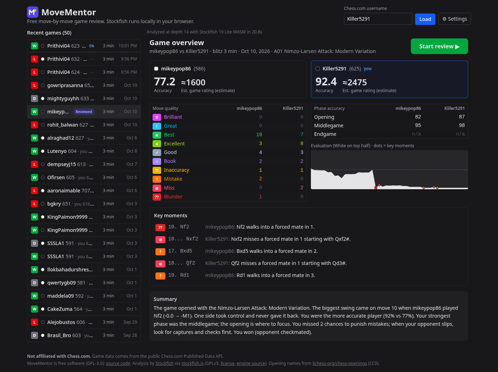
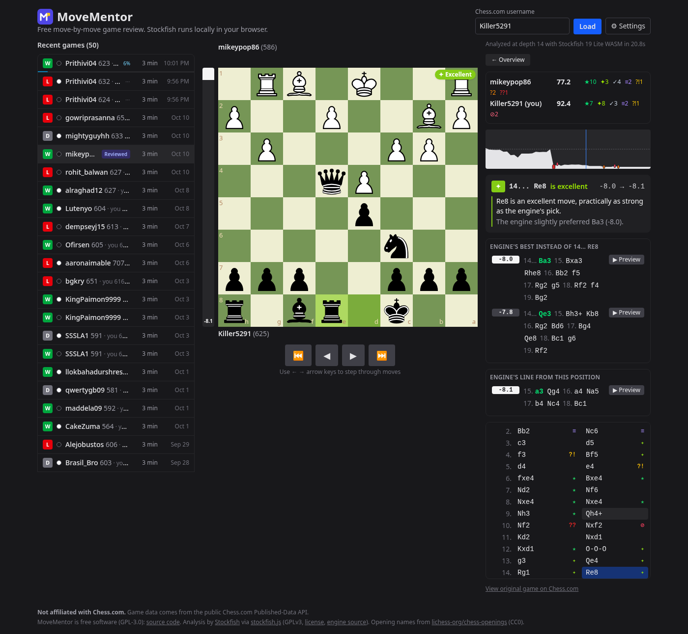
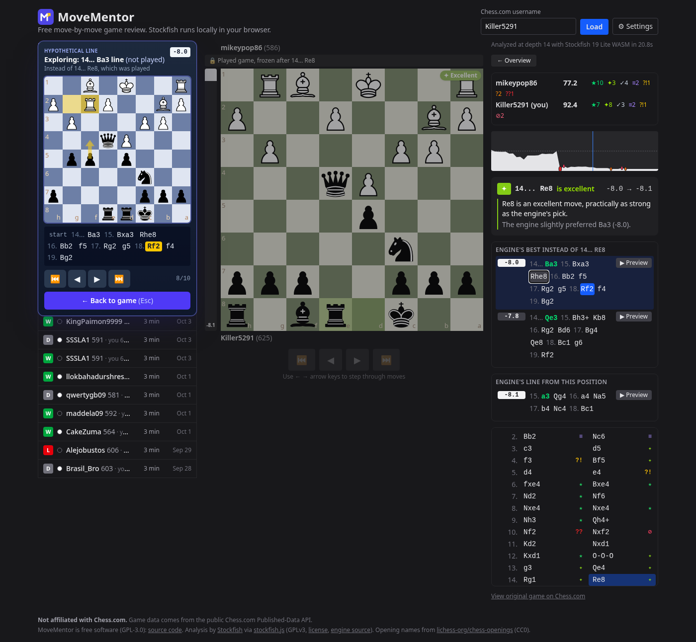
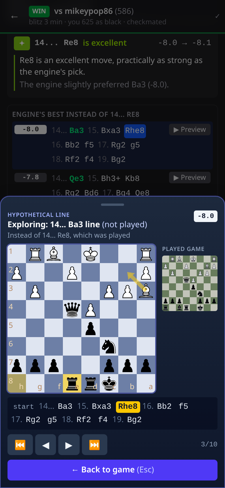
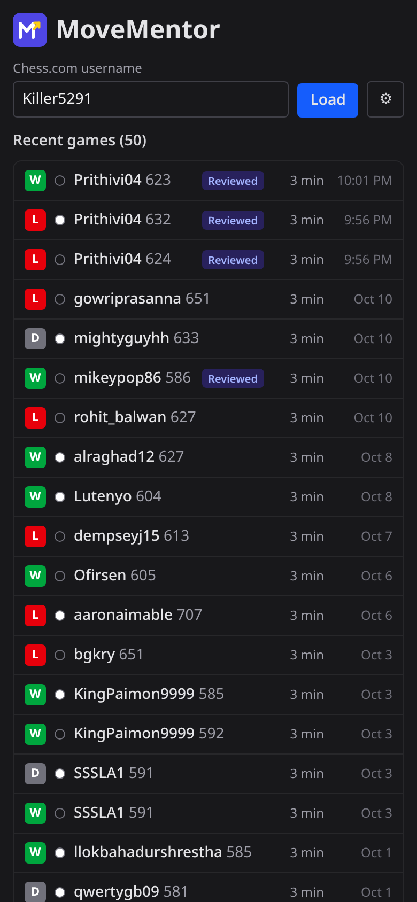
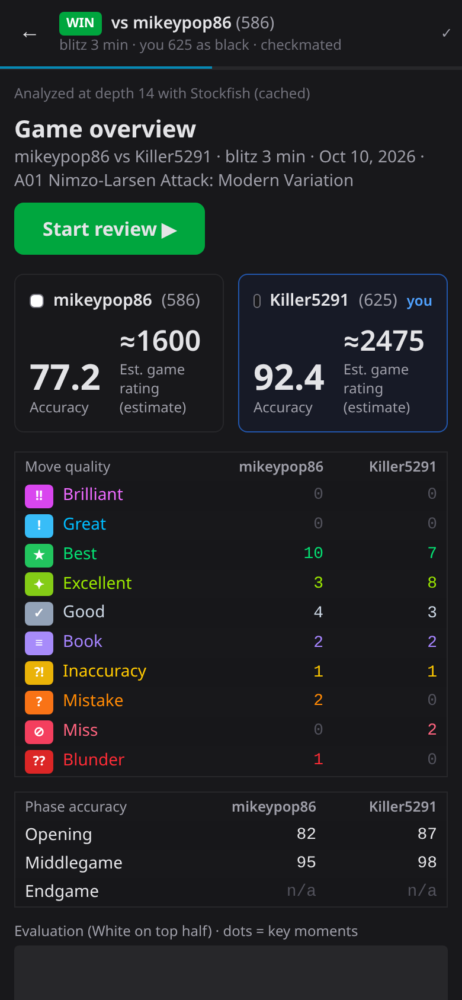

<p align="center"></p>

# MoveMentor

**MoveMentor** is a free, open-source chess game review app. Enter a Chess.com username, pick a recent game,
and Stockfish analyzes every move **inside your browser** (WebAssembly in a Web Worker), so there's no
server-side engine cost.

> MoveMentor is an independent project. **Not affiliated with Chess.com.** It only reads public game data
> from the Chess.com Published-Data API.






<p>
  
  
</p>

## Features

- Pulls recent games from the public Chess.com Published-Data API (no login, no premium).
- Game list: compact one-line cards (result chip, your color, opponent + rating, time control, date) with a
  **Reviewed** badge for games whose analysis is already cached.
- **Mobile-first navigation:** on narrow screens (< 1024px) the list and the review are separate views. Tapping a game
  opens a full-screen review at `/game/<id>` with a sticky header (back button, result, opponent, analysis progress);
  back returns to the list at the same scroll position. Desktop keeps the side-by-side layout (`/?user=…&g=<id>`
  deep links; `/game/<id>` redirects there on wide screens).
- **Background preloading:** after the list loads, the newest 3 un-reviewed games are analyzed one at a time in the
  same worker while the tab is visible and idle, with subtle % progress on the list item. On touch devices it only
  runs while `navigator.getBattery()` reports charging (no Battery API means no preloading on mobile). Opening a game
  pauses preloading so your game gets the engine first; it resumes afterwards. Turn it off under ⚙ Settings
  ("Preload newest games"); settings persist in `localStorage`. Chess.com requests stay sequential.
- Move-by-move Stockfish 19 (lite, single-threaded WASM) analysis at a configurable depth
  (default 14; `?depth=` URL param or the dropdown).
- **Game overview first**: accuracy per player, an *estimated* game rating (labelled as a rough estimate),
  a Brilliant→Blunder counts table per player, phase accuracy (opening/middlegame/endgame), an eval graph with
  markers at brilliant/great/miss/mistake/blunder moments, a key-moments list with one-liners, a rule-based summary
  paragraph and a **Start review** button.
- **Ten move classes** with an original icon/color scheme: Brilliant `!!`, Great `!`, Best `★`, Excellent `✦`,
  Good `✓`, Book `≡`, Inaccuracy `?!`, Mistake `?`, Miss `⊘`, Blunder `??`.
- **Coach explanations** for every move (good and bad), rule-based, no AI: hanging pieces, material won/lost along
  the engine line, forks, pins, skewers, mates allowed/missed, captures/recaptures, checks, castling, promotion,
  trading when ahead, missed punishments, "only move" situations, with varied wording.
- Review UI: board with move navigation (buttons + ← → Home End keys), color-coded move list,
  eval bar, clickable win% graph, green arrow showing the engine's best move on inaccuracies/mistakes/blunders,
  best line in SAN, per-player accuracy, ACPL and classification counts, progress bar during analysis.
- **Engine lines for every move:** the panel shows the engine's top move with its full principal variation
  (SAN with move numbers) and eval from the position *before* the move ("Engine's best instead of …"), the
  2nd-best line (MultiPV 2, toggle "2nd-best line"), and the engine's line from the position *after* the move.
- **Line explorer overlay:** click any move in a line (or "▶ Preview") and a separate raised card slides out with
  its own slate-blue board theme. It has an "Exploring: 17... Rg8 line (not played)" header, the line's eval, a move strip
  with the current move highlighted, step controls and "Back to game". On desktop (≥ lg) it slides out to the left of
  the real board, over the game list. On narrow screens it's a bottom sheet with a mini "Played game" board. The real
  board stays at the played position, dimmed and labelled "Played game, frozen". ← → / Home / End / Esc drive the
  overlay while it's open. Open/close is animated and respects `prefers-reduced-motion`.
- Results are cached in `localStorage` per game + depth + MultiPV (LRU eviction when storage is full).

## Run it

```bash
npm install          # postinstall copies the Stockfish WASM build into public/stockfish/
npm run dev          # http://localhost:3000  (optional: ?user=Killer5291&g=<gameId>&depth=14)
npm run build && npm start   # production
```

Tests / checks:

```bash
npm test                                   # unit tests: classifier, sacrifice detection, tactics, explainer, parser
npm run test:analysis -- Killer5291 0 14   # headless: fetch a real game, run Stockfish in Node, print classifications
npm run screenshot -- 5 28                 # needs dev server + Playwright (python) + Chrome; args: game index, ply
                                           # writes overview/move/overlay/mobile list/mobile review screenshots, tests
                                           # preloading + pause, settings persistence, overlay keys, Esc/close,
                                           # mobile list -> /game/<id> -> back with scroll restore, reduced motion
SHOW_LINES=1 npm run test:analysis -- Killer5291 0 14   # also print top + 2nd engine line for every move
```

Requires Node.js ≥ 20.9.

### Environment variables

| Variable | Required | Default | Purpose |
|---|---|---|---|
| `MOVEMENTOR_USER_AGENT` | no | `MoveMentor (https://github.com/J-grok-bot/movementor)` | User-Agent sent to the Chess.com API (add a contact email if you run a public instance) |
| `NEXT_PUBLIC_EXPLANATION_RENDERER` | no | `rules` | Optional explanation wording layer (see below); leave unset |

## Deploy to Vercel

1. Import the GitHub repo in Vercel; the framework preset **Next.js** is detected automatically.
2. Defaults work as-is: install `npm install` (its `postinstall` copies the Stockfish files into `public/stockfish/`,
   which are also committed), build `npm run build`, output handled by Next.js. Node.js 20.x or newer.
3. Optionally set `MOVEMENTOR_USER_AGENT`. No other env vars, database or storage are needed.

There are no server-side filesystem dependencies: the only server code is `/api/games`, which calls the Chess.com
API with `fetch`. Stockfish (`public/stockfish/*.js|.wasm`) and the opening book (`public/openings.json`) are static
files. No COOP/COEP headers are needed because the single-threaded engine doesn't use SharedArrayBuffer;
`next.config.ts` only sets `application/wasm` + long cache headers.

## Architecture

```
src/app/page.tsx              Client UI: username form, game list, review panel (desktop side-by-side)
src/app/game/[id]/page.tsx    Full-screen mobile review with sticky header
src/lib/engineManager.ts      Shared Stockfish worker + lock; user analysis pre-empts background preloading
src/lib/preloader.ts          Background preloading (visibility, idle, battery/charging, settings)
src/lib/settings.ts, analysisCache.ts, gamesStore.ts   localStorage settings, analysis cache, session game-list cache
src/app/api/games/route.ts    GET /api/games?username=…  → server fetch from Chess.com (descriptive User-Agent,
                              sequential requests, 5-min revalidate cache), returns normalized GameSummary[]
src/lib/chesscom.ts           Chess.com API client + normalization (result, color, time control, opening)
src/lib/analysis.ts           Pure analysis core (runs in browser AND Node): PGN → per-position engine evals (MultiPV) →
                              win% loss → classification, accuracy, ACPL, engine lines (SAN). Also a UCI/MultiPV parser
                              and helpers for numbered lines / preview FENs.
src/lib/classify.ts           Pure classifier (10 classes) with documented thresholds
src/lib/tactics.ts            chess.js helpers: material, hanging pieces, forks, pins/skewers, line playback
src/lib/explain.ts            Fact detection + varied rule-based templates; pluggable ExplanationRenderer
src/lib/overview.ts           Phase accuracy, rating estimate, key moments, summary paragraph
src/lib/openingBook.ts        Opening-book lookup; data in public/openings.json (built by scripts/build-openings.mjs)
src/components/LineExplorer.tsx  Engine-line explorer overlay (side card on desktop, bottom sheet on mobile)
src/components/Overview.tsx   Overview screen shown after analysis
src/lib/browserEngine.ts      Web Worker wrapper around /stockfish/stockfish-19-lite-single.js (UCI over postMessage)
src/components/Review.tsx     Board (react-chessboard), nav, eval bar/graph, move list, summary
scripts/copy-stockfish.mjs    Copies the engine (js+wasm) and GPL text from node_modules/stockfish into public/
scripts/test-analysis.ts      Headless end-to-end test using the same analysis code with Stockfish in Node
```

### How moves are classified

1. Every position (N moves → N+1 positions) is searched with `go depth D`, MultiPV 2 by default. Terminal positions
   (checkmate/stalemate/draw) are scored directly without the engine.
2. Scores are normalized to White's perspective, then converted to **win %** with the Lichess model
   `50 + 50·(2/(1+e^(-0.00368208·cp)) − 1)`; mate scores map to 100%/0%.
3. For each move the mover's win% drop = winBefore − winAfter, and `classifyMove()` (src/lib/classify.ts) decides,
   in this order:

| Class | Rule |
|---|---|
| **Book** | every move so far is in the bundled opening book (lichess-org/chess-openings, CC0; 3,865 lines / 7,982 positions) |
| **Brilliant** | best or within 2% of best, **and** a sacrifice of ≥ 2 pawns of material (still down 3 plies later along the engine line and not recovered by ply 5, or a ≥ minor piece left en prise), mover still ≥ 50% after, not already ≥ 97%; not counted if in check, a piece was already hanging, or the 2nd-best line loses the same material |
| **Great** | engine's top move and the MultiPV-2 line is ≥ 15 win% worse ("only move"); excludes recaptures and obvious captures of hanging/higher-value pieces |
| **Best** | engine's top move |
| **Excellent** | < 2 win% lost |
| **Good** | < 10 win% lost |
| **Inaccuracy / Mistake / Blunder** | ≥ 10 / ≥ 20 / ≥ 30 win% lost |
| **Miss** | opponent's previous move lost ≥ 10%, the best line would have won ≥ 2 pawns of material (or mated), the played move lost ≥ 10%, but the mover is still ≥ 40%; also a missed forced mate while staying ≥ 40% |

   Allowing a new forced mate is at least a Mistake. Thresholds live in `THRESHOLDS` in `src/lib/classify.ts`.
4. Per-move accuracy = `103.1668·e^(−0.04354·drop) − 3.1669` (Lichess formula; book moves = 100), player accuracy =
   mean of the arithmetic and harmonic means. ACPL uses centipawns with mates capped at ±1000.
5. Phases: opening = book moves or the first 20 plies while > 10 minor/major pieces remain; endgame = ≤ 6 minor/major
   pieces; otherwise middlegame. The **estimated game rating** is a piecewise-linear mapping from accuracy only
   (e.g. 55% ≈ 750, 75% ≈ 1500, 88% ≈ 2200). It is a motivational estimate, not a rating.

### Coach explanations

`detectFacts()` turns each move into structured facts (capture, recapture, check, castle, promotion, hanging piece,
fork/pin/skewer by the played move / the engine's best move / the opponent's best reply, material won or lost along the
engine line, measured at two horizons and sanity-checked against the eval, mate allowed/missed/threatened, trade
when ahead, sacrifice, only-move gap, missed punishment). `renderRuleBased()` picks the main cause and renders it with
deterministic, varied templates.

**Optional wording layer (off by default):** implement `ExplanationRenderer` (`render(input, ruleBased) →
Promise<Explanation>`), call `registerExplanationRenderer()`, and set `NEXT_PUBLIC_EXPLANATION_RENDERER=<id>`. The
renderer receives the structured `facts` so an LLM can only rephrase verified facts. Nothing in this repo calls an LLM.

## Distribution notes

**Chess.com API etiquette** (https://www.chess.com/news/view/published-data-api)
- Send a descriptive `User-Agent` with contact info (default `MoveMentor (https://github.com/J-grok-bot/movementor)`,
  override with `MOVEMENTOR_USER_AGENT`).
- Make requests serially, not in parallel; handle `429` by backing off. The route does this and caches for 5 minutes.
  At scale, add a persistent cache (e.g. per-archive month; past months never change) and use `ETag`/`If-None-Match`.
- The data is public but read-only; don't imply an official relationship.

**Branding**
- Don't call it "Chess.com Game Review" or use Chess.com logos, piece sets, colors-as-trade-dress, or classification
  icons that mimic theirs (e.g. "Brilliant!!" badges). Keep the "Not affiliated with Chess.com" footer.
  This app ships under its own name, MoveMentor, with an original logo and classification icons.

**Stockfish license (GPLv3)**
- Stockfish and the `stockfish` npm package (stockfish.js) are GPLv3. Serving the engine's `.js`/`.wasm` to users'
  browsers is *distributing* it, so you must: ship the license (`public/stockfish/COPYING-GPLv3.txt`, linked in the
  footer), provide the corresponding source for the engine build (link to https://github.com/nmrugg/stockfish.js and
  the exact version, or host the source), and keep any modifications to the engine under GPLv3.
- Whether the rest of the app must be GPL depends on how tightly it's combined. Running the engine as a separate
  worker that talks UCI text over `postMessage` is generally treated as a separate program ("aggregate"), similar to
  a GUI talking to a UCI engine binary, but this is a legal judgment, not a technical one. The simplest safe path for a
  public release is to open-source the whole app under GPLv3. If you want a closed-source app, get legal advice first.
- Wrapping it as a mobile app (e.g. Capacitor) is still distribution; the same obligations apply, and some app stores'
  terms have historically conflicted with GPL. Check before submitting.

## Limitations / next steps

- MultiPV 2 costs roughly 3x the time of a single line (about 7 s → about 24 s for an 80-ply game at depth 14 here).
  Untick "2nd-best line" (or `?lines=1`) for speed. PVs at fixed depth can be long and speculative toward the end.
- The lite network is weaker than full Stockfish; fixed depth 12–14 is quick (~3–7 s per game here) but can be noisy
  in sharp positions. Results can differ slightly between runs because engine hash state affects the search.
  Options: offer depth 18+, a "deep" mode with the full 94 MB build, or MultiPV to label "only move"/"great" moves.
- Classes and explanations are heuristics on a fixed-depth lite engine. Brilliant/Great are deliberately strict, so
  they are rare in fast low-rated games. Tactic detection is static (pins/forks/skewers by the moved piece or the
  engine's first reply), so deeper combinations are described only via material/eval changes.
- Endgame phase accuracy can rest on just a few moves.
- No trend tracking across many games yet.
- Only the 3 most recent monthly archives / 50 games are listed; add pagination and Lichess support.
- Daily/correspondence and variant games: variants are filtered out.

## License and attribution

MoveMentor is free software licensed under the **GNU General Public License v3.0** (see [LICENSE](LICENSE)).
The whole app is GPL-3.0 because it ships Stockfish.

- **Stockfish** (https://stockfishchess.org, source: https://github.com/official-stockfish/Stockfish) by the Stockfish
  developers, GPLv3. The WebAssembly build is **stockfish.js** by Nathan Rugg and contributors
  (https://github.com/nmrugg/stockfish.js, npm `stockfish` 19.0.1, GPLv3). It's served unmodified from
  `public/stockfish/`, with its license text at `public/stockfish/COPYING-GPLv3.txt`.
- **Opening names** from lichess-org/chess-openings (https://github.com/lichess-org/chess-openings), CC0, converted
  by `scripts/build-openings.mjs` into `public/openings.json` (source TSVs in `data/`).
- **chess.js** (BSD-2-Clause) and **react-chessboard** (MIT).
- Game data: public Chess.com Published-Data API. Not affiliated with Chess.com.
